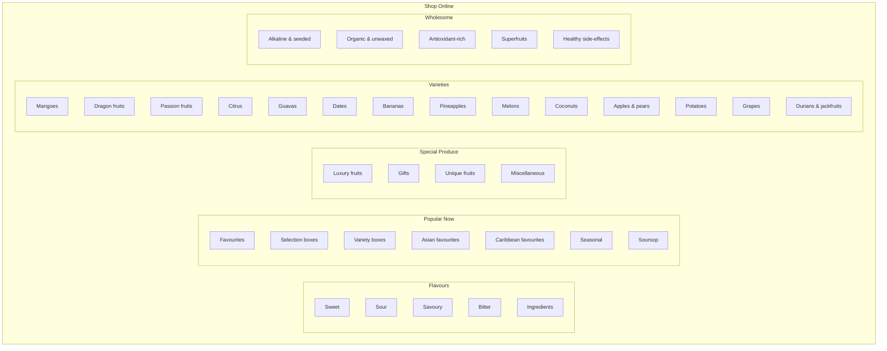

# My Exotic Fruit

Currently hosted on EKM.
In future, we plan to switch to being a static website with a custom build pipeline for shared components, generated content, SEO, and other reusable functionality.
I'm not a huge fan of [EKM's dev docs](https://tags.ekm.com) but they aren't BAD by any means.
Worse is that I don't particularly like how their custom elements look, and their tags are messy imo.

## Categories



## Project
This project relies on a custom [build pipeline](./BUILD-PIPELINE.md)!
Build with 
```bash
node build.js
```

and deploy from the created `build` folder.